<picture>
  <source media="(prefers-color-scheme: dark)" srcset="https://raw.githubusercontent.com/saaivignesh20/saaivignesh20/output/header-dark.svg">
  
</picture>

### What I'm building

I'm the co-founder and CTO of [Deep Variance](https://www.deepvariance.com). We get more outputs from the same GPUs:
open-source diffusion models, tuned to the hardware they run on, and the products built on top of them.

- **[DV4](https://dv4.ai)**: describe a video and DV4 films it, shot by shot, with people who speak in sync, music,
  on-screen text and captions. Landscape or vertical, up to 4K.
- **[Piku](https://piku.dv4.ai)**: accurate, cost-effective images through one API, from tuned open-source models on our
  inference stack.
- **[Overdrift](https://www.deepvariance.com/stack)**: our optimized diffusion inference stack. It profiles your traffic,
  tunes each diffusion model to the GPU that runs it and checks every change against the original model, on your own GPUs.

Deep Variance is backed by Cintrifuse Capital and Plug and Play, and is a member of NVIDIA Inception.

### Activity

<picture>
  <source media="(prefers-color-scheme: dark)" srcset="https://raw.githubusercontent.com/saaivignesh20/saaivignesh20/output/stats-dark.svg">
  
</picture>

<picture>
  <source media="(prefers-color-scheme: dark)" srcset="https://raw.githubusercontent.com/saaivignesh20/saaivignesh20/output/snake-dark.svg">
  
</picture>

### Recently shipped

<!-- shipped:start -->
| | Project | Shipped | Date |
|:-:|---|---|---|
|  | **DV4** | `v1.10.6` build 3707, agentic AI video platform | Nov 24, 2026 |
|  | **Piku** | `v1.36` build 1162, image generation API | Nov 24, 2026 |
|  | [**piku-integrations**](https://github.com/saaivignesh20/piku-integrations) | [READMEs: Piku's goal](https://github.com/saaivignesh20/piku-integrations/commit/749094cc40130400faaf5d9914acfe023a5009dc) | Nov 14, 2026 |
|  | [**BetterTot**](https://github.com/saaivignesh20/BetterTot) | [`v0.3.4`](https://github.com/saaivignesh20/BetterTot/releases/tag/v0.3.4) [test: align pad color expectation](https://github.com/saaivignesh20/BetterTot/commit/d03168e098147aed51e73f14d90ff94bbf5f69e0) | Aug 25, 2026 |
|  | [**saaivignesh20.github.io**](https://github.com/saaivignesh20/saaivignesh20.github.io) | [fix: restore github.io project routing](https://github.com/saaivignesh20/saaivignesh20.github.io/commit/c1fe46e3d6ce0870a83c875fa1b855de4097387b) | Aug 21, 2026 |
|  | [**deepvariance/vscode-extension**](https://github.com/deepvariance/vscode-extension) | [docs: cut the README back down](https://github.com/deepvariance/vscode-extension/commit/e2ad3297a1b1c604a682689ac39e767077ca3bee) | Jul 16, 2026 |
<!-- shipped:end -->

 open source, linked to the code &nbsp;&nbsp;  closed source

### Architecture and scale

- **Deep Variance, CTO:** I design how DV4, Piku and Overdrift fit together, from the agent that plans a film to the GPUs
  that render it. A speed-up ships only after its output is checked against the original model's.
- **[CNS, Indiana University](https://cns.iu.edu/people/saai-vignesh-premanand) (2025):** production tools for the NIH Human Reference Atlas in Angular, TypeScript and
  Node.js, with SonarQube, Jest and Storybook; contributor to [hra-ui](https://github.com/hubmapconsortium/hra-ui).
- **StellarLogix (2024):** designed RSquare, a serverless IoT platform on AWS IoT Core and Lambda. Devices switch between
  CoAP, MQTT and REST to save battery on LTE; the design was proven in proofs of concept and written up as the reference
  architecture. Also built Ramix, a cloud platform for electronic shelf labels (NestJS, Prisma, PostgreSQL, Auth0
  role-based access, installable PWA).
- **Calibraint (2021 to 2023):** led five developers building ConSource, an enterprise procurement platform that connects
  buyers with 4,000+ consulting firms, with SAML single sign-on, MFA and three languages on AWS. Led three on Improveo, a
  consulting network with real-time chat.

### Stack

<picture>
  <source media="(prefers-color-scheme: dark)" srcset="https://skillicons.dev/icons?i=py,pytorch,ts,react,nextjs,nodejs,swift,docker,cloudflare,azure,aws,postgres,supabase,linux&theme=dark">
  
</picture>

The cards and the shipped list refresh every 6 hours from GitHub's API and the products' release pages
([workflow](.github/workflows/profile.yml)).
