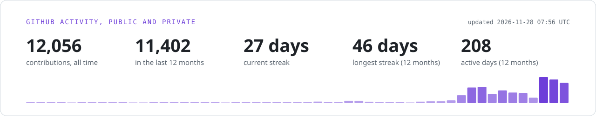

<picture>
  <source media="(prefers-color-scheme: dark)" srcset="https://raw.githubusercontent.com/saaivignesh20/saaivignesh20/output/header-dark.svg">
  
</picture>

### What I'm building

I'm the co-founder and CTO of [Deep Variance](https://www.deepvariance.com). We get more outputs from the same GPUs:
open-source diffusion models, tuned to the hardware they run on, and the products built on top of them.

- **[DV4](https://dv4.ai)**: describe a video and DV4 films it: planned shot by shot, with people who speak in sync,
  music, on-screen text and captions. Landscape or vertical, up to 4K.
- **[Piku](https://piku.dv4.ai)**: accurate, cost-effective images through one API, from tuned open-source models on
  DV4's inference stack.
- **[Auto-tuning inference stack](https://www.deepvariance.com/stack)**: profiles your traffic, tunes each diffusion model
  to the GPU that runs it and verifies each change against the original model. On your own GPUs.

Deep Variance is backed by Cintrifuse Capital and Plug and Play, and is a member of NVIDIA Inception.

### Activity

<picture>
  <source media="(prefers-color-scheme: dark)" srcset="https://raw.githubusercontent.com/saaivignesh20/saaivignesh20/output/stats-dark.svg">
  
</picture>

<picture>
  <source media="(prefers-color-scheme: dark)" srcset="https://raw.githubusercontent.com/saaivignesh20/saaivignesh20/output/snake-dark.svg">
  
</picture>

### Recently shipped

<!-- shipped:start -->
- [**piku-integrations**](https://github.com/saaivignesh20/piku-integrations) · [READMEs: Piku's goal](https://github.com/saaivignesh20/piku-integrations/commit/749094cc40130400faaf5d9914acfe023a5009dc) · Nov 14, 2026
- [**BetterTot**](https://github.com/saaivignesh20/BetterTot) · [`v0.3.4`](https://github.com/saaivignesh20/BetterTot/releases/tag/v0.3.4) · [test: align pad color expectation](https://github.com/saaivignesh20/BetterTot/commit/d03168e098147aed51e73f14d90ff94bbf5f69e0) · Aug 25, 2026
- [**saaivignesh20.github.io**](https://github.com/saaivignesh20/saaivignesh20.github.io) · [fix: restore github.io project routing](https://github.com/saaivignesh20/saaivignesh20.github.io/commit/c1fe46e3d6ce0870a83c875fa1b855de4097387b) · Aug 21, 2026
- [**mana.ai**](https://github.com/saaivignesh20/mana.ai) · [add chrome extension locally](https://github.com/saaivignesh20/mana.ai/commit/46bc98d2336bd3c0d352f3a4868629d5700bc8f3) · Jul 30, 2025
<!-- shipped:end -->

### Stack

<picture>
  <source media="(prefers-color-scheme: dark)" srcset="https://skillicons.dev/icons?i=py,pytorch,ts,react,nextjs,nodejs,swift,docker,cloudflare,azure,aws,postgres,supabase,linux&theme=dark">
  
</picture>

Full-stack roots: tools for the NIH Human Reference Atlas at CNS, Indiana University; IoT cloud platforms at StellarLogix;
enterprise procurement software at Calibraint.

The cards and the shipped list refresh every 6 hours from GitHub's API ([workflow](.github/workflows/profile.yml)).
